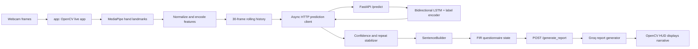

# AI Guidebook: IPD SignLangInt

## 1. Project Brief

IPD SignLangInt is a desktop, webcam-based sign gesture interpreter connected to a structured First Information Report (FIR) incident-intake workflow. It recognizes labels from short, dynamic hand movements, turns stable labels into text, collects that text across a fixed questionnaire, and can ask a backend language model to draft one incident narrative from the collected answers.

The project is a prototype for assisted communication and report drafting. It is not a general-purpose sign-language translator, a validated transcription system, or a legal decision-making system. The classifier only recognizes labels represented by its training data. The generated report can be wrong or omit meaning; a human must review it before any official use.

When modifying the project, distinguish three different outputs:

- **Gesture label:** the class predicted by the trained sequence classifier.
- **Collected answer:** labels assembled by the local app and saved under the current FIR question.
- **Incident narrative:** optional text returned by the backend report generator from all saved answers.

These stages have separate state and separate failure modes.

## 2. System at a Glance



There are two independently launched processes:

1. **Backend:** FastAPI loads the classifier at startup and serves prediction and report requests.
2. **Desktop app:** OpenCV captures the webcam, MediaPipe detects hands, and the app sends prediction requests to the backend asynchronously.

The backend does not access the webcam. The live app does not load or run the Keras model itself.

## 3. Repository Map

### Active application and domain code

| Path | Responsibility |
| --- | --- |
| `app/main.py` | Desktop application entry point. |
| `app/live_interpreter.py` | Owns camera loop, frame processing, prediction stabilization, answer editing, FIR navigation, and report request. |
| `app/hud.py` | Draws hand landmarks, current question, prediction, input text, controls, and report overlay. |
| `server/main.py` | FastAPI app, service construction, `/predict`, and `/generate_report`. |
| `server/schemas.py` | Pydantic request and response shapes for both endpoints. |
| `server/gesture_predictor.py` | Loads and warms the classifier once for the API process. |
| `server/report_generator.py` | `ReportGenerator` interface, Groq-backed implementation, and missing-key fallback. |
| `sign_language/config.py` | Shared feature dimensions, sequence size, thresholds, asset paths, and backend URL. |
| `sign_language/features.py` | Converts one hand's 21 landmarks into normalized coordinates and joint angles. |
| `sign_language/landmarker.py` | MediaPipe wrapper and right/left-hand feature-vector assembly. |
| `sign_language/smoothing.py` | Exponential moving average for frame features. |
| `sign_language/stabilizer.py` | Confidence filtering and temporal label stability. |
| `sign_language/sentence.py` | De-duplicates repeat labels and joins fingerspelled letters into text. |
| `sign_language/fir.py` | Fixed questionnaire and per-question answer state machine. |
| `sign_language/prediction_client.py` | Client interface and background-thread HTTP implementation. |
| `sign_language/gesture_model.py` | Keras model architecture, training, persistence, warm-up, and inference. |
| `sign_language/dataset.py` | Stores and loads dynamic samples as NumPy arrays. |
| `sign_language/augmentation.py` | Adds synthetic samples to underrepresented classes. |
| `tools/collect_dataset.py` | Webcam-based dynamic gesture recording CLI. |
| `tools/balance_dataset.py` | Dataset balancing CLI; target is currently 500 samples per label. |
| `tools/train.py` | Loads the sequence dataset and trains the classifier. |

### Root-level utilities

- `sync_dataset.py` imports/reconciles NumPy samples and a CSV manifest. It is an auxiliary data-management script, not required by the active trainer.
- `backfill_presence_flags.py` migrates old static CSV files from 147 to 149 columns. It is a legacy CSV workflow and is not used by the active dynamic NumPy pipeline.
- `gesture_lstm.keras` is the trained model artifact currently present in the project directory.
- `Readme.md` contains a short setup summary. This guide reflects the inspected implementation where the README and files differ.

## 4. Runtime Data Flow

### 4.1 Frame to feature vector

`LiveInterpreterApp` opens camera device index `0`, mirrors each frame, converts it to RGB, and passes it to `HandLandmarkerService`. MediaPipe can detect up to two hands. Each detected hand has 21 `(x, y, z)` landmarks.

For each hand, `extract_hand_features`:

1. Subtracts the wrist landmark from every landmark.
2. Divides shifted coordinates by the maximum wrist-to-landmark distance, making the coordinates wrist-centered and approximately scale-normalized.
3. Flattens 21 three-dimensional points into 63 values.
4. Appends 10 joint angles in degrees.

The layout is right-hand features first, then left-hand features. An undetected hand is represented by 73 zeros. Thus:

- Per hand: `21 * 3 + 10 = 73` values.
- Per frame: `73 * 2 = 146` values.
- Model input: `30` frames by `146` features.

Hand side comes from MediaPipe handedness classification, not screen position. Preserve this ordering and shape when changing preprocessing, recording data, or the model. Training data produced with a different convention will not be compatible without migration/retraining.

### 4.2 Smoothing, prediction, and acceptance

`FeatureSmoother` uses an exponential moving average with `alpha = 0.5` by default. For each visible-hand frame, the smoothed vector is appended to a `deque` limited to `SEQUENCE.seq_len` (30).

Once the history is full, the app attempts prediction every third processed hand frame. `HttpPredictionClient` allows at most one prediction request in flight; requests run on a daemon thread, so HTTP latency does not stop camera rendering. While a request is in flight, new requests are skipped rather than queued.

The backend runs the classifier and returns the highest-probability label and its confidence. The app's `PredictionStabilizer`:

- Discards predictions below the configured confidence threshold (`0.50` by default) by adding an empty value to its rolling window.
- Emits a label only when it occupies the entire stable window (`4` predictions by default).
- Resets after a prolonged hand absence.

This behavior suppresses noisy output but can delay recognition. In particular, it requires four matching accepted results in the current buffer; it is not a majority-vote threshold smaller than the full window.

If a hand disappears briefly, the app repeats the last smoothed feature vector for up to 10 frames. After that it clears the prediction buffer, frame history, smoother, and sentence repeat guard. Collection is different: `tools.collect_dataset` only appends frames with a detected hand and clears an incomplete sequence after 10 no-hand frames.

### 4.3 Stable labels to text

`SentenceBuilder` prevents the same stable label from being appended repeatedly without an intervening different label. Consecutive one-character labels are concatenated as fingerspelling; multi-character gesture labels become their own token. `delete_last` removes one character from the final spelled token when applicable, otherwise removes the final token.

There is no separate explicit space-insertion command. Gesture labels and fingerspelling boundaries therefore determine how tokens are formed. Keep this behavior in mind when changing class labels or input editing.

### 4.4 FIR question state

The questionnaire is a fixed ten-step list in `sign_language/fir.py`:

1. Name (spell it)
2. What happened (examples shown: theft, attack, kidnap)
3. When it happened (time)
4. Where it happened (location)
5. Vehicles involved
6. Actions
7. Stolen items or injuries
8. Description of the accused
9. Evidence or witnesses
10. Other information

`FIRWorkflow` stores a separate list of words for each step. `N` saves the current answer and moves forward; `B` saves and moves back. The new step's saved answer becomes the editable current input. `C` clears the current input but does not erase every stored answer. `D`/Backspace deletes the last character/token. `Enter` saves the current answer and compiles every step; unanswered steps are serialized as `N/A`. The time step is specially formatted by `_format_time`.

The compiled text contains each question followed by its answer, one question per line. That string, not raw video or landmark data, is sent to the report endpoint.

### 4.5 Report generation

`POST /generate_report` forwards the compiled answers to the configured `ReportGenerator`. If `GROQ_API_KEY` is set, the backend uses Groq's `llama-3.3-70b-versatile` model by default. The prompt asks for one formal paragraph, combines spelled letters into names, omits `N/A`, and says not to invent details. Prompt instructions are not a guarantee of factual accuracy.

Without the key, `UnavailableReportGenerator` returns a configuration message. The desktop app displays returned text in its HUD. The API currently catches report-generation exceptions and returns the exception text inside a successful response body; callers should not assume a non-error HTTP status proves a valid report was generated.

## 5. Backend API Contract

The default base URL is `http://localhost:8000` (`SERVER` in `sign_language/config.py`).

### `POST /predict`

Request:

```json
{"sequence": [[0.0, 0.0]]}
```

The example is abbreviated. The actual request must contain a 30-row sequence, each row containing 146 numeric values. If fewer than 30 rows arrive, the endpoint returns an empty prediction and confidence `0.0`. For a full sequence, the response is:

```json
{"prediction": "LABEL", "confidence": 0.97}
```

The backend loads model and label encoder during module initialization. If the predictor is not ready, `/predict` returns HTTP 500. The service logs a warning when the model or encoder cannot be loaded.

### `POST /generate_report`

Request:

```json
{"compiled_inputs": "Step 1: Your Name?: A B C\n..."}
```

Response:

```json
{"generated_sentence": "..."}
```

There is no authentication, persistence, health endpoint, or request-size policy defined in the inspected API. Do not expose this prototype backend publicly without addressing those concerns.

## 6. Data Collection and Model Training

### Dataset format

The active dataset root is `dynamic_dataset/` (`PATHS.dataset_dir`). Samples are stored as:

```text
dynamic_dataset/
  manifest.csv
  ATTACK/
    ATTACK_<timestamp>.npy
  HELP/
    HELP_<timestamp>.npy
```

Each `.npy` file is a float32 array intended to have shape `(30, 146)`. The class label is the containing directory name. `SequenceDataset.load_all` reads the directory structure directly and skips arrays with the wrong frame count; it does not use or validate the manifest and does not currently validate feature count.

The manifest written by `SequenceDataset.save_sample` has columns `file_path,label,frames,created_at`. The separate `sync_dataset.py` uses a wider schema including `source_type`, validates `(30, 146)`, and has its own path assumptions. Avoid treating either manifest as the trainer's source of truth.

### Attached dataset snapshot

The attached `dynamic_dataset/` was inspected on 2026-10-01. It contains 30,050 `.npy` files in 49 class folders:

- Digits: `0` through `9`.
- Fingerspelled letters: `A` through `Z`.
- Word/action labels: `ATTACK`, `BIKE`, `CAR`, `DRINK`, `DRIVE`, `HELP`, `HOUSE`, `KIDNAP`, `MALE`, `PULL`, `PUSH`, `THEFT`, and `truck`.

The per-class counts range from 500 to 881 files. Every scanned file was readable, had shape `(30, 146)`, and contained finite values. This is a structural check only; it does not establish that labels are correct, gestures are diverse, classes are semantically consistent, or train/test splits avoid related samples.

The manifest is incomplete relative to the actual directories: it contains 24,277 rows for 42 labels, while seven folder labels (`BIKE`, `CAR`, `DRINK`, `DRIVE`, `PULL`, `PUSH`, and `truck`) have no manifest rows. Four manifest paths no longer resolve to files. The active loader ignores the manifest and scans class folders, so training will include valid on-disk files missing from the manifest. Do not use manifest totals as dataset totals.

There is a class-name case inconsistency: `truck` is lowercase while the other word labels are uppercase. `SequenceDataset.load_all` uses the folder name as the class label, so it trains a distinct lowercase `truck` class. The existing trained model and encoder, if supplied later, must use the same label convention. Normalize this only as a deliberate dataset/model change followed by retraining and paired-artifact replacement.

The filename audit found 24,261 files with `staticconv` in their names and 5,789 without that marker. This indicates that the dataset combines converted static samples with other sequence recordings. The conversion source and temporal validity cannot be established from shape checks or filenames alone; inspect the conversion procedure before treating every sample as a genuinely dynamic gesture.

### Typical workflow

1. Ensure the MediaPipe task asset is available at the configured path.
2. Record examples with `python -m tools.collect_dataset`; enter a label, then make repeated examples of that dynamic sign. Press `Esc` to finish.
3. Optionally run `python -m tools.balance_dataset` to synthesize classes below the 500-sample target.
4. Run `python -m tools.train` to load arrays and train/save the model and label encoder.
5. Restart the backend so it loads the new artifacts.

The collector records rolling groups of 30 detected-hand frames and saves a sample as soon as the group is full, then starts the next group. The capture CLI does not apply the live app's EMA smoother. For reproducibility and inference quality, dataset collection and deployment preprocessing should remain aligned; this difference is a point to consider before comparing training and live results.

### Model behavior

`GestureClassifier` uses a sequential Bidirectional LSTM classifier: two 64-unit bidirectional LSTM layers, dropout, a 64-unit dense layer, and a softmax output. Training uses a stratified 80/20 split, class weights, a validation split, early stopping, and best-validation-accuracy checkpoints. Labels are encoded with scikit-learn's `LabelEncoder` and persisted with joblib.

The model and label encoder are a pair: their output class order must match. Retrain or distribute both artifacts together. The trainer writes `label_encoder.pkl`; `server/gesture_predictor.py` expects it next to `gesture_lstm.keras`.

### Augmentation caveat

`sign_language/augmentation.py` perturbs stored landmark coordinate blocks and recomputes joint angles. Its implementation applies noise to both hand blocks, including blocks that were all zeros for an absent hand. Inspect augmented examples for unintended synthetic hand signal before relying on a balanced dataset. Synthetic sample generation also writes `.npy` files directly and does not add manifest rows.

## 7. Setup and Running

Use Python compatible with the installed TensorFlow and MediaPipe wheels. The declared dependencies are in `requirements.txt`.

```powershell
cd IPD---SignLangInt
py -m venv .venv
.venv\Scripts\Activate.ps1
python -m pip install --upgrade pip
python -m pip install -r requirements.txt
```

Create a local `.env` from `.env.example` and set `GROQ_API_KEY` only if report generation is wanted. `.env` is ignored by Git.

Start the backend in one terminal:

```powershell
uvicorn server.main:app --reload
```

Start the camera app in a second terminal:

```powershell
python -m app.main
```

Keyboard controls: `N` next question, `B` previous question, `C` clear current input, `D` or Backspace delete, `Enter` request the report, and `Esc` exit.

## 8. Required Assets and Verified Gaps

`sign_language/config.py` expects these paths in the project root:

- `hand_landmarker.task`: required by MediaPipe for both live use and collection.
- `gesture_lstm.keras`: classifier weights; currently present in the attached project directory.
- `label_encoder.pkl`: required alongside the model to map output indices back to labels.
- `dynamic_dataset/`: present in the attached project and needed for training, but not for serving an already-trained model.

The inspected attached directory contains `gesture_lstm.keras` and `dynamic_dataset/`, but does **not** contain `hand_landmarker.task` or `label_encoder.pkl`. Therefore, this checkout is not currently ready for live capture or model inference until those missing assets are supplied or generated. The training command can create a label encoder from the dataset, but it also replaces/retrains the classifier; it does not provide the MediaPipe task asset.

Do not silently rename, replace, or retrain model artifacts to work around missing files. Confirm the intended asset source and make sure the model and matching encoder come from the same training run.

## 9. Legacy and Auxiliary Utilities

### `sync_dataset.py`

This script imports `.npy` files, validates a hard-coded `(30, 146)` shape, and synchronizes a manifest. It imports `pandas`, but `pandas` is not listed in the project's `requirements.txt`. It also defaults to a working-directory-relative `dynamic_dataset` path, whereas the main package uses a path relative to `config.py`. Use an explicit `--dataset-dir` and install the needed dependency if using this utility. The active `tools.train` command does not call it.

### `backfill_presence_flags.py`

This one-time migration handles old framewise CSV data: 147-column rows become 149-column rows by inserting left/right presence flags. It imports `pandas`, which is also absent from `requirements.txt`, and its own usage text references another converter that is not part of this project. It does not migrate files used by `SequenceDataset` and is not part of current training/inference.

## 10. Change-Safety Guidance for AI Contributors

Before changing behavior, identify which layer owns it and preserve the contracts below:

- **Preprocessing contract:** one frame is 146 values in right-then-left order; one sample is 30 frames. Keep `config.py`, capture, training, and inference consistent.
- **Artifact contract:** `gesture_lstm.keras` and `label_encoder.pkl` must be from the same training run. Do not commit or overwrite user data/model artifacts casually.
- **State ownership:** gesture stabilization and assembled text live in the app; answers by question live in `FIRWorkflow`; prediction/model state lives in the backend.
- **Transport boundary:** `PredictionClient` and `ReportGenerator` exist to keep their implementations replaceable. Prefer implementing those interfaces over coupling callers to a provider.
- **Configuration:** use `sign_language/config.py` for shared shapes, paths, thresholds, and URL rather than duplicating constants.
- **User-visible text:** answer tokens originate from classifier labels. A change to class naming can alter spelling and report prompts even when the model shape remains the same.
- **No automated test suite was present** in the inspected project directory. For changes, use focused checks where possible and verify both the app/backend interaction and the relevant training or data path.
- **Privacy and safety:** video is processed locally by the camera app and feature sequences are sent to the configured backend for inference. Compiled answers are sent to the report provider through the backend when configured. Treat incident information as sensitive; do not add logging or persistence of it without explicit need and safeguards.

Useful entry points when investigating a change:

- Live recognition behavior: `app/live_interpreter.py` and `sign_language/stabilizer.py`.
- Feature incompatibility or poor predictions: `sign_language/config.py`, `sign_language/features.py`, `sign_language/landmarker.py`, and the dataset/training path.
- Wrong answer assignment or report content: `sign_language/sentence.py`, `sign_language/fir.py`, `server/schemas.py`, and `server/report_generator.py`.
- Startup failures: configured assets, `server/gesture_predictor.py`, `server/main.py`, and MediaPipe initialization in `sign_language/landmarker.py`.

## 11. Source of Truth and Scope Notes

This guide was written from the implementation in this project directory. If a description here conflicts with runtime behavior, follow the code and update the guide in the same change. In particular, treat generated dataset contents and local secrets as user data, and do not infer classifier vocabulary from the questionnaire examples: the output classes are determined by the paired trained model and label encoder.